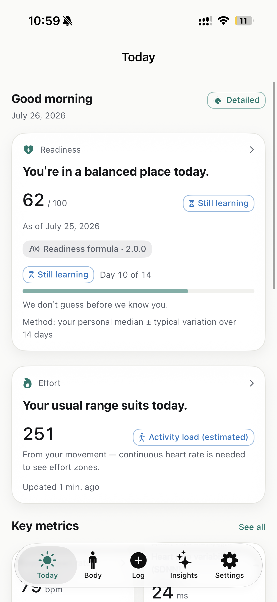
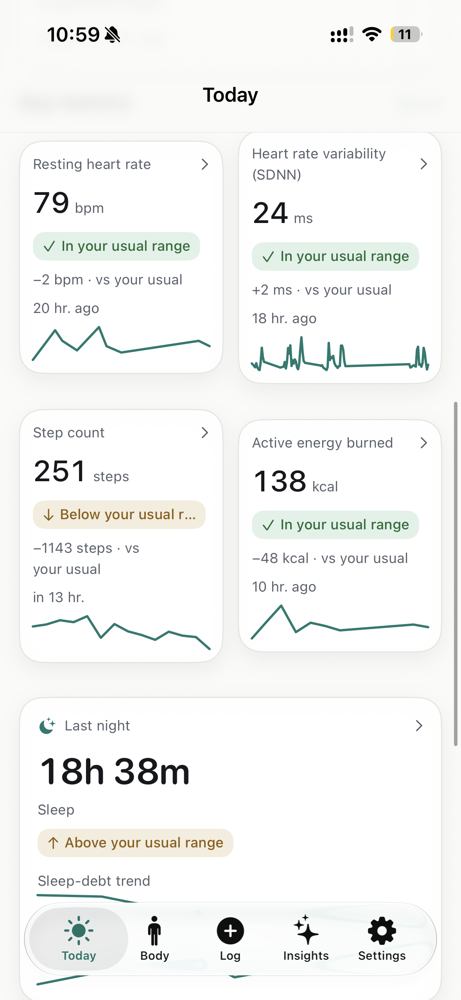
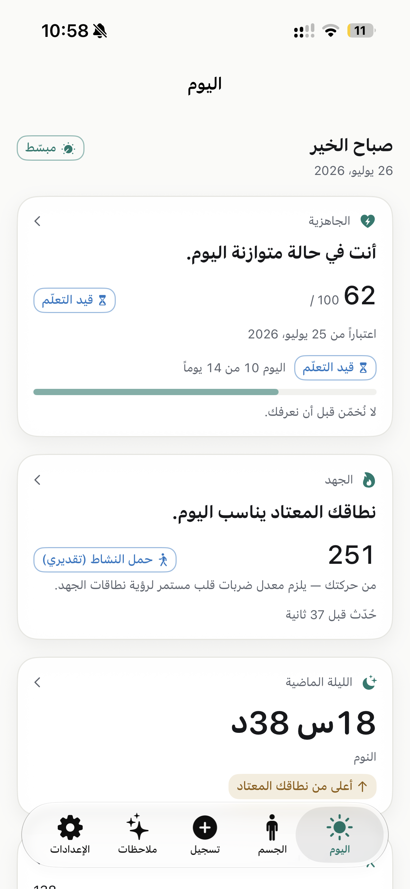
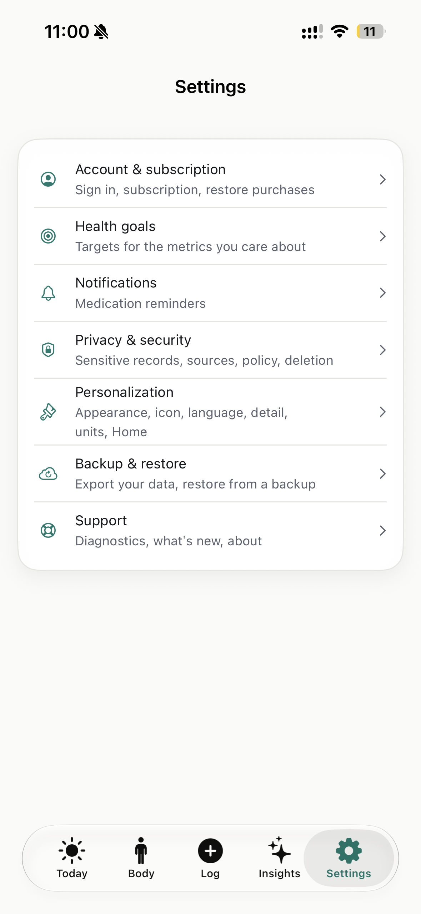

# BADAN

**A privacy-respecting, local-first personal health repository.** BADAN unifies wearable,
behavioral, and self-reported health data into one user-controlled model, rendered at two
altitudes: calm and casual by default, deep and inspectable for power users. Raw data is never
paywalled; provenance is preserved end-to-end; everything works offline.

> Status: iOS flagship is a **runnable, compiled app** (Xcode 26 / iOS 17+). Android is the
> next milestone against the same shared contracts. See `docs/adr/ADR-0006`.

## Screenshots (real device, iPhone)

Real seeded data flowing through ingestion → sleep dedup → 14-day baselines → derived
readiness, rendered at two altitudes and in both languages.

| Today · casual | Today · power | Today · Arabic (RTL) | Settings |
|---|---|---|---|
|  |  |  |  |

The casual view is calm cards + status words; the power view is the *same data* with signed
deviations vs your median, 14-day sparklines, and the algorithm string (`ƒ(x)
composite.readiness_score · 1.0.0`). The Arabic build fully mirrors the layout (tab bar,
chevrons, badges) and formats durations in Arabic (`6س 31د`). Status is never red/green — one
calm amber + an arrow marks "outside your usual range".

## What works today (iOS)

- Real canonical domain model, SQLite persistence in two DB files (main + sensitive namespace).
- Real HealthKit ingestion (sleep, heart rate, resting heart rate, steps; 90-day backfill,
  incremental anchored reads) behind an explicit connect flow (onboarding + Data Sources), all
  through the same `HealthStorePort` seam a deterministic 90-day fake source uses when a user
  skips connecting — either path is honest about which one it is; nothing is fabricated.
- Ingestion → unit normalization → timezone/day attribution → **sleep dedup** with a reversible
  decision journal.
- 14-day median/MAD **personal baselines**, append-only derived values, and wellness-safe
  template **insights** (English + Arabic).
- **~15 real screens** across both altitudes: Today, Body/metric detail + anatomy sheet,
  Timeline, Log hub, Symptom/Medication/Workout/Nutrition logging, Export center, Settings,
  Provenance, Insights, Onboarding.
- **Export**: CSV + JSON + checksummed manifest, raw/derived/suppressed separable, fully offline.
- **Customization**: depth (casual↔power), units, language + RTL, theme, home modules.

## Repository layout

| Path | What |
|---|---|
| `packages/` | Shared, language-neutral source of truth: metric ontology, insight templates, symptom dictionary, export schema |
| `apps/ios/` | The runnable SwiftUI app (project generated from `project.yml` via XcodeGen) |
| `apps/android/` | Kotlin/Compose parallel path (mirrors the iOS architecture) |
| `docs/` | PRD, architecture, ADRs, execution plan, blueprint, design specs |
| `backend/`, `infra/` | Dormant in MVP (local-first, no backend — ADR-0002) |
| `scripts/` | Dev helpers (resource sync, run/reset) |

## Build & run (iOS)

Requirements: macOS with Xcode 26+, and `xcodegen` (`brew install xcodegen`).

```bash
cd apps/ios
xcodegen generate            # regenerate BADAN.xcodeproj from project.yml (it is gitignored)
open BADAN.xcodeproj         # or build from the CLI:
xcodebuild -project BADAN.xcodeproj -scheme BADAN \
  -sdk iphonesimulator -destination 'platform=iOS Simulator,name=iPhone 17' build
```

Or use the helper: `scripts/run_ios.sh` (build, boot the simulator, install, launch).
On first launch the app seeds a realistic demo dataset; **Settings → Reset demo data** re-seeds.

## Tests

```bash
cd apps/ios && xcodegen generate
xcodebuild -project BADAN.xcodeproj -scheme BADAN \
  -sdk iphonesimulator -destination 'platform=iOS Simulator,name=iPhone 17' test
```

## Shared contracts

Ontology/insight/symptom/export data is authored in `packages/` and mirrored into the app
bundle with `scripts/sync_ios_resources.sh`. Both platforms consume the same files, so a metric
or symptom is added once. See `docs/architecture.md`.

## Product guardrails

Raw data is not paywalled · provenance is preserved · casual and power are one model at two
altitudes · wellness-safe language only (no diagnosis/treatment) · Arabic/RTL is first-order ·
privacy is architectural (local-first, no network in MVP).

## Source license

The [Binjamshid Public Fork License, Version 1.0](LICENSE) covers only software that
binjamshid has the rights to license and publicly releases under it. An owner-authorized
public source release that designates this license is required for it to take effect.
Any rights previously granted remain in effect under their original terms. The
[BADAN app EULA](docs/legal/eula.html) governs the mobile app distribution it describes.

The source license permits use, modification, and redistribution subject to its terms.
Commercial use by or on behalf of a for-profit organization is prohibited. Publish the
corresponding source for every modified version, including private and local edits, in
a publicly accessible version-control repository under the same license. Publish within
30 calendar days of making the change, or before distributing the version or letting
others use it as a service, whichever comes first, subject to the license's coordinated
security-fix exception.

Third-party material retains its own terms and notices.

- The Gradle wrapper scripts and JAR in `apps/android/` and the Material icons adapted
  in `apps/android/app/src/main/res/drawable/ic_shortcut_*.xml` are under the
  [Apache License 2.0](LICENSE-APACHE-2.0).
- LOINC codes in `packages/contracts/analytes/analytes.json` and
  `apps/ios/Sources/Resources/analytes.json` carry the [LOINC terms](https://loinc.org/license).
  The UCUM references in `packages/contracts/analytes/units.json` and
  `apps/ios/Sources/Resources/lab_units.json` carry the [UCUM terms](https://ucum.org/license).
