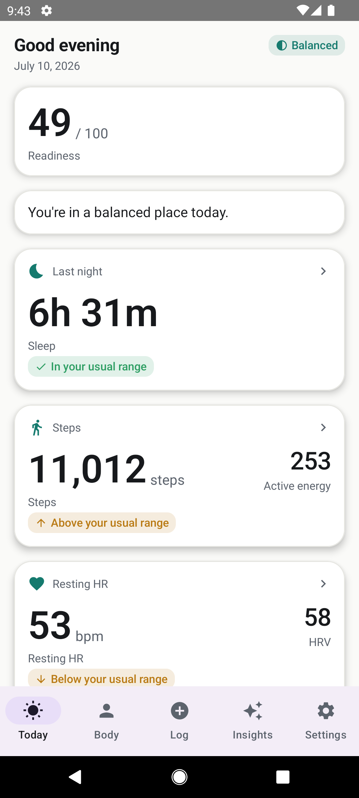
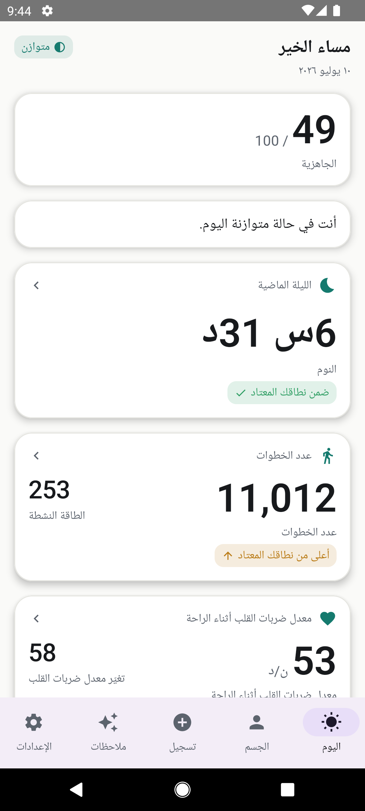
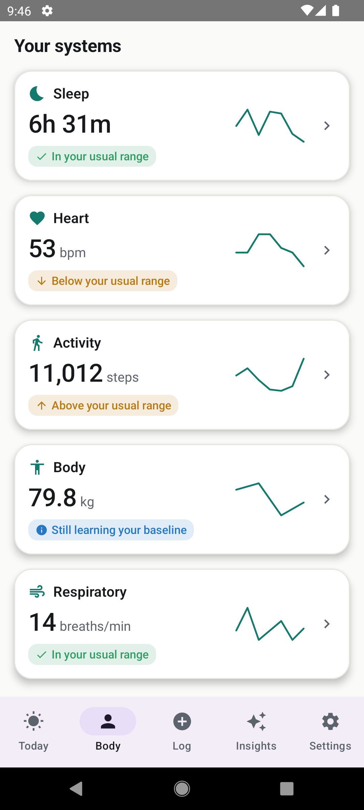
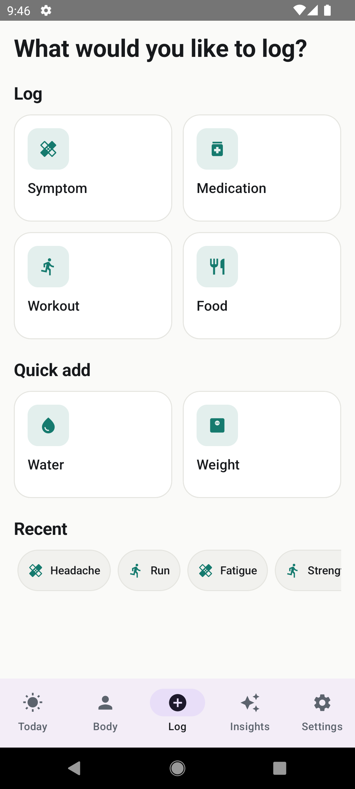
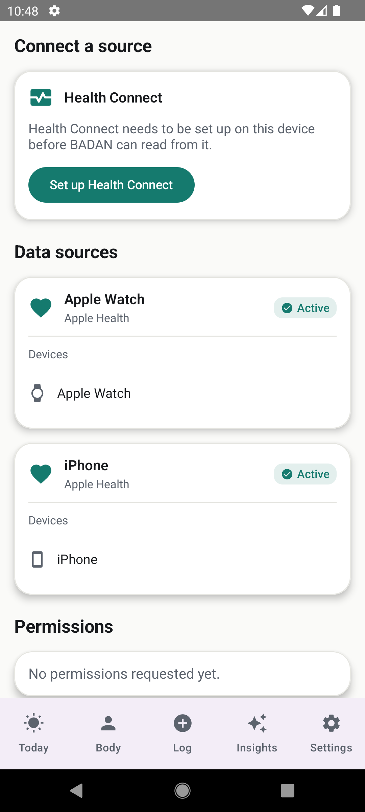

# BADAN Android

The native **Kotlin / Jetpack Compose** app — a **runnable, compiled** parallel to the iOS
flagship (ADR-0006), not a rewrite. It consumes the **same shared truth** as iOS and mirrors the
same architecture, so parity is structural. See `docs/android-parity-status.md` for exact status.

## Screenshots (Medium_Phone emulator, seeded data)

The same deterministic data as iOS flows through the same ported ingestion → dedup → baseline
logic — Readiness 49, sleep 6h 31m, steps 11,012, RHR 53, HRV 58 — rendered in native Compose.

| Home | Home · Arabic (RTL) | Body | Log hub | Data sources · Health Connect |
|---|---|---|---|---|
|  |  |  |  |  |

## What Android reuses (no re-authoring)

Everything language-neutral in `packages/` is the single source of truth for both apps:

| Shared artifact | iOS consumes as | Android consumes as |
|---|---|---|
| `packages/metric-ontology/registry.json` | `MetricRegistry` | `MetricRegistry` (bundled asset) |
| `packages/contracts/insights/templates.json` | `InsightTemplateStore` | insight template store |
| `packages/contracts/dictionaries/symptoms.json` | `SymptomDictionary` | symptom dictionary |
| `packages/export-schemas/csv_columns.json` | `CSVWriter` | CSV writer |
| The logical schema (`docs/data-model.md`) | raw SQLite (`Database`) | **framework SQLite** (ADR-0007, same table/column names) |
| Invariants I1–I8, ADRs, vertical slices | — | — |

An asset-copy step (mirroring `scripts/sync_ios_resources.sh`) copies the `packages/` JSON into
`app/src/main/assets/`.

## Mapping the iOS architecture to Android

| iOS | Android |
|---|---|
| SwiftUI + `@Observable` view models | Compose + `ViewModel` + `StateFlow` |
| raw SQLite via `SQLiteConnection` | framework SQLite via `SqliteConnection` (ADR-0007, same DDL, no Room/KSP) |
| `HealthStorePort` + `FakeHealthStore` + `HealthKitAdapter` | same port; `FakeHealthStore` + `HealthConnectAdapter` |
| `IngestionPipeline` / `DedupLite` / `BaselineEngine` | mirrored (duplicated-logic budget, D-4) |
| two DB files (`badan.db` + `badan_sensitive.db`) | two SQLite databases |
| `CustomizationProfile.depthPolicy` dual-altitude | same presentation switch |

## Conformance parity

A behavior "exists" only when both platforms pass the same fixtures (the drift firewall). The
iOS unit/pipeline tests (`apps/ios/Tests/`) define the expected canonical rows, dedup outcomes,
baseline numerics, and export bytes that the Android suite must reproduce identically.

## Build (once the Gradle project is added)

## Build & run

Requires the Android SDK (platform 36) and JDK 21. AGP needs JDK 17–21, so point Gradle at a
JDK 21 (Android Studio ships one as its JBR):

```bash
export JAVA_HOME="/Applications/Android Studio.app/Contents/jbr/Contents/Home"   # or any JDK 21
cd apps/android
./gradlew :app:assembleDebug        # build the debug APK
./gradlew test                      # unit tests

# Run on an emulator (see scripts/run_android.sh for a one-shot build+boot+install+launch):
$ANDROID_HOME/emulator/emulator -avd Medium_Phone &
./gradlew :app:installDebug
adb shell am start -n net.binjamshid.badan/.MainActivity
```

Or open `apps/android` in Android Studio and Run.

## Performance sign-off device tier

`minSdk = 26` (Android 8.0, 2017-era hardware) is the supported floor, but day-to-day development
happens on whatever emulator/device is at hand — typically mid-to-high-end. Before signing off on
a performance-sensitive change (startup time, write batching, recomposition), also check it on a
low-end reference profile, not just `Medium_Phone`:

```bash
# One-time: create a low-end reference AVD (2 GB RAM, 2 cores, API 26)
avdmanager create avd -n Low_End_API26 -k "system-images;android-26;google_apis;x86_64" \
  -d "Nexus 5" --force
# then edit the AVD's config.ini (or Android Studio's AVD Manager) to cap RAM at ~2 GB
# and vCPU count at 2 to approximate the `minSdk` floor.

scripts/run_android.sh Low_End_API26
```

## Stack

Kotlin 2.0.21 · Jetpack Compose (BOM 2024.10.01) · Material 3 · AGP 8.9.1 / Gradle 8.11.1 ·
framework SQLite (ADR-0007, no Room/KSP) · kotlinx.serialization · Health Connect 1.1.0 ·
compileSdk 36 / minSdk 26 · `applicationId net.binjamshid.badan` (Kotlin package/namespace stays
`net.albayyan.badan`, see `apps/android/app/build.gradle.kts`). Package layout mirrors iOS:
`core/ domain/ ontology/ storage/ platform/health/ export/ designsystem/ features/ app/`.

See `docs/android-parity-status.md` for exactly what is done, partial, and deferred, and
EXECUTION_PLAN §11 (AP-06/08/10/12) for the original packet breakdown.
